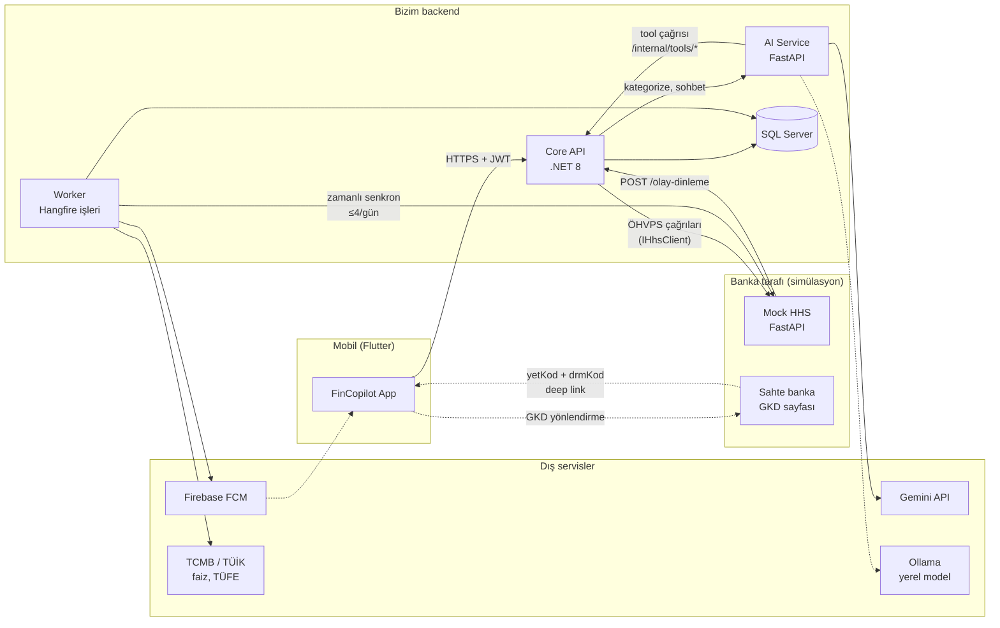
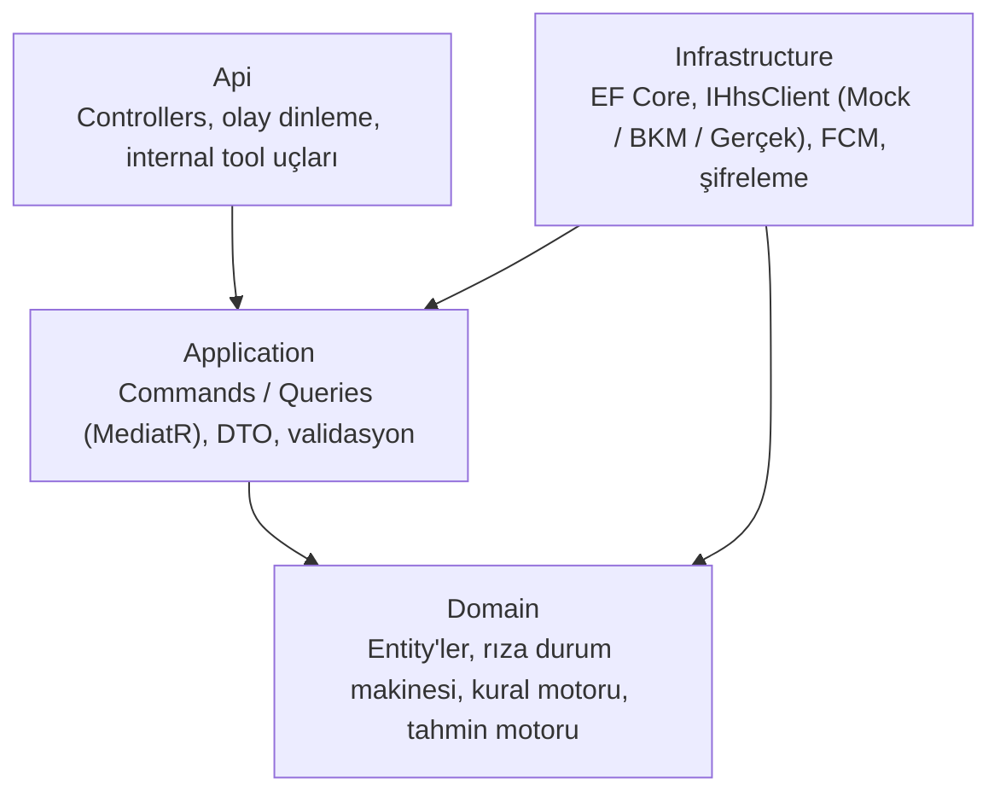
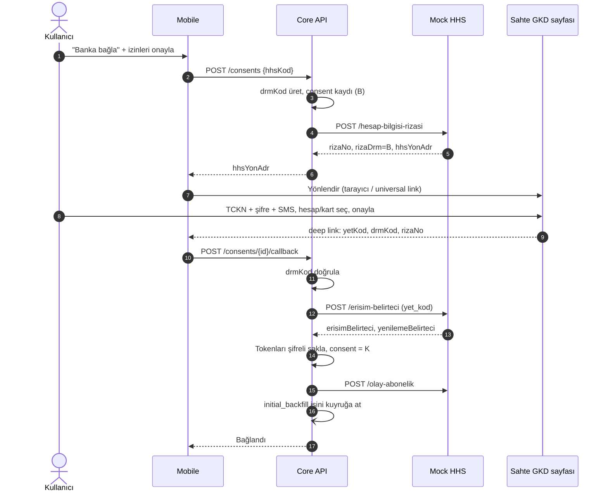
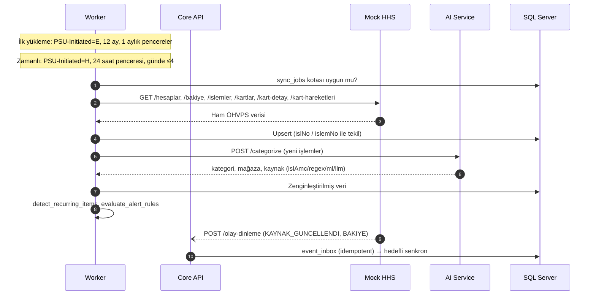
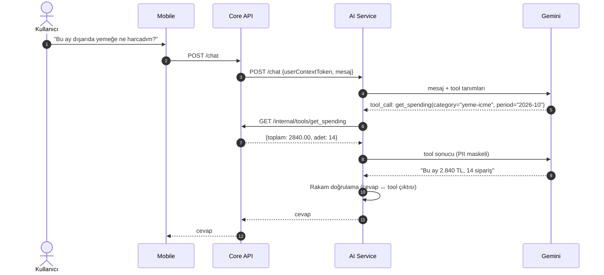

# Sistem Mimarisi

> İlke: **LLM konuşur, backend hesaplar, kural motoru karar verir.**

## 1. Genel görünüm

## 2. Bileşenler ve sorumluluklar

| Bileşen | Sorumluluk | Teknoloji |
|---|---|---|
| **Mobile** | Arayüz, banka bağlama akışı, sohbet ekranı, widget, push alma | Flutter |
| **Core API** | Kimlik, rıza yönetimi, ÖHVPS istemcisi, analitik ve kural motoru, LLM tool uçları, olay dinleme | .NET 8, Clean Architecture, CQRS/MediatR, EF Core |
| **Worker** | Zamanlı senkronizasyon, uyarı kuralları, sabah brifingi, rıza süresi kontrolü, faiz ve TÜFE güncelleme | Hangfire (Core API ile aynı çözüm, ayrı süreç) |
| **AI Service** | Kategorizasyon (Regex → ML → LLM fallback), tekrarlayan kalem tespiti, LLM orkestrasyonu, PII maskeleme, rakam doğrulama | Python, FastAPI, scikit-learn |
| **Mock HHS** | ÖHVPS v2.0.0 Hesap Bilgisi uçları, sahte GKD sayfası, sentetik veri, olay gönderimi | Python, FastAPI |
| **SQL Server** | Tüm kalıcı veri + Hangfire iş deposu (bkz. [veritabani.md](veritabani.md)) | SQL Server 2022 |

### Hesaplama nerede yapılır?
- **Deterministik her şey Core API'de:** bakiye, borç, kart döngüsü, kart önerisi, nakit akışı, günlük limit, simülasyon. Birim testleri burada.
- **Olasılıksal her şey AI Service'te:** kategori tahmini, tekrar örüntüsü tespiti, doğal dil.
- AI Service veritabanına **doğrudan erişmez**. Veriyi sadece Core API'nin `/internal/tools/*` uçlarından okur.

## 3. Core API katmanları (Clean Architecture)

`IHhsClient` bir **adapter** arayüzü: `MockHhsClient` (bitirme), `BkmSimulatorClient` (opsiyonel), `LicensedProviderClient` (gelecek). Gerçek ortama geçiş = yeni adapter + konfigürasyon.

## 4. Akışlar

### 4.1 Banka bağlama (rıza + yönlendirmeli GKD)

### 4.2 Senkronizasyon

### 4.3 Sohbet (LLM + tool çağrısı)

## 5. Güvenlik kararları

| Konu | Karar |
|---|---|
| Banka şifresi | Hiç görülmez; sadece sahte banka sayfasına girilir |
| ÖHVPS tokenları | Veritabanında AES-GCM ile şifreli, mobile asla inmez |
| TCKN, IBAN | Şifreli saklanır; arama için ayrı hash sütunu |
| LLM'e giden veri | PII maskeli, sadece tool çıktısı ve özet |
| LLM yetkisi | Sadece okuma tool'ları; yazma yok |
| Internal tool uçları | Sadece servis ağı + kısa ömürlü, kullanıcıya bağlı servis token'ı |
| GKD dönüşü | `drmKod` ile CSRF koruması, tek kullanımlık |
| Olay dinleme | `olayNo` ile idempotent; mock'ta imza opsiyonel, gerçekte JWS zorunlu |

## 6. Ortamlar

| Ortam | İçerik |
|---|---|
| Yerel | `docker compose up`: SQL Server, Core API, Worker, AI Service, Mock HHS |
| Demo | Aynı compose, Hetzner VPS, GitHub Actions ile dağıtım |
