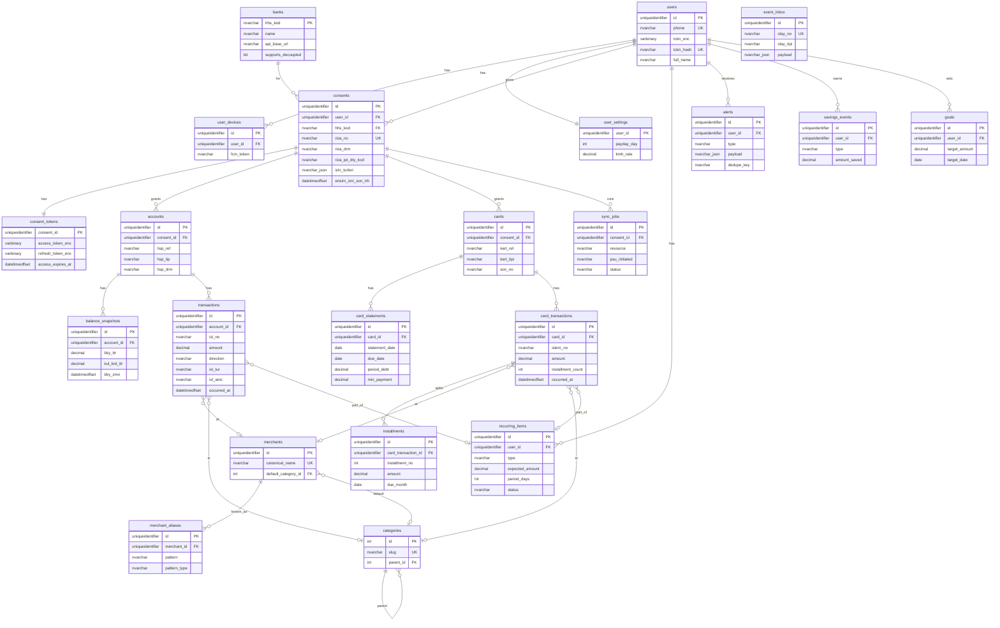

# Veritabanı Şeması

Microsoft SQL Server 2022 · EF Core (code-first) · Para tutarları `decimal(19,4)` · Zamanlar `datetimeoffset` (UTC) · Kimlikler `uniqueidentifier` (sıralı GUID, `NEWSEQUENTIALID()` / EF Core sequential GUID)

| Kavram | SQL Server karşılığı |
|---|---|
| JSON alanlar (`payload`, `evidence`, `fx_info`, `izin_turleri`) | `nvarchar(max)` + `CHECK (ISJSON(col) = 1)` |
| Şifreli alanlar (`*_enc`) | `varbinary(max)` (uygulama tarafında AES-GCM) |
| Boolean | `bit` |
| Metin | `nvarchar(n)` (Türkçe karakter için) |
| Tek aktif rıza kısıtı | Filtered unique index |

## 1. ER diyagramı

## 2. Tablolar

### Kimlik
| Tablo | Sütunlar | Not |
|---|---|---|
| `users` | id, phone (UK), tckn_enc, tckn_hash (UK), full_name, pin_hash, created_at | TCKN AES-GCM ile şifreli; arama hash ile |
| `user_devices` | id, user_id, device_id, platform, fcm_token, last_seen_at | Cihaz bağlama + push |
| `user_settings` | user_id (PK), payday_day, kmh_rate, card_interest_rate, late_interest_rate, timezone, notify_daily_brief, notify_alerts | Faiz oranları varsayılan TCMB azami, kullanıcı düzeltebilir |

### Rıza ve senkronizasyon
| Tablo | Sütunlar | Not |
|---|---|---|
| `banks` | hhs_kod (PK), name, logo_url, api_base_url, supports_decoupled, is_active | HHS-YÖS API'den doldurulur |
| `consents` | id, user_id, hhs_kod, riza_no (UK), riza_drm (B/Y/K/S/I), riza_ipt_dty_kod, izin_turleri (JSON dizi, örn. `["01","03"]`), erisim_izni_son_trh, hesap_isl_bsl_zmn, hesap_isl_bts_zmn, gkd_yontem (Y/A), drm_kod_hash, created_at, updated_at | **Kısıt:** (user_id, hhs_kod) için tek aktif rıza → `WHERE riza_drm IN ('B','Y','K')` filtered unique index |
| `consent_tokens` | consent_id (PK), access_token_enc, access_expires_at, refresh_token_enc, refresh_expires_at, updated_at | Şifreli; sadece Infrastructure okur |
| `sync_jobs` | id, consent_id, resource, psu_initiated (E/H), window_start, window_end, status, http_status, error_code, started_at, finished_at | Günde ≤4 sistem sorgusu kotası bu tablodan sayılır |
| `event_inbox` | id, olay_no (UK), olay_tipi, kaynak_tipi, kaynak_no, payload (JSON), received_at, processed_at | Olay dinleme idempotency |

### Hesap ve kart verisi (ÖHVPS'ten)
| Tablo | Sütunlar | Kaynak alan |
|---|---|---|
| `accounts` | id, user_id, consent_id, hhs_kod, hsp_ref, hsp_no_enc, hsp_no_masked, hsp_shb, sube_adi, kisa_ad, urun_adi, para_birimi, hsp_tur, hsp_tip, hsp_drm, acilis_trh, is_active · **UK** (consent_id, hsp_ref) | `hspTml`, `hspDty` |
| `balance_snapshots` | id, account_id, bky_ttr, blk_ttr, para_birimi, kul_krd_ttr, krd_dhl_gstr, bky_zmn, source (sync/event) | `bky`, `krdHsp` |
| `transactions` | id, account_id, isl_no, ref_no, amount, currency, direction (B/A/N), isl_tur, isl_amc, kanal, description_raw, ohk_msj, counterparty_name, counterparty_iban_masked, occurred_at, merchant_id, category_id, category_source, category_confidence, recurring_item_id · **UK** (account_id, isl_no) | `islTml`, `islDty` |
| `cards` | id, user_id, consent_id, hhs_kod, kart_ref, son_no, kart_tipi, alt_kart_tipi, kart_formu, kart_turu, kart_statu, kart_sema, urun_adi · **UK** (consent_id, kart_ref) | kart listesi (07) |
| `card_statements` | id, card_id, statement_date, due_date, period_debt, min_payment, credit_limit, used_limit, cash_limit, used_cash_limit, currency, fetched_at | kart-detay (08) ⚠ alan adları doğrulanacak |
| `card_transactions` | id, card_id, islem_no, occurred_at, amount, currency, installment_count, isl_turu, merchant_raw, description_raw, fx_info (JSON), merchant_id, category_id, category_source, category_confidence, recurring_item_id · **UK** (card_id, islem_no) | kart-hareketleri (09) ⚠ |
| `installments` | id, card_transaction_id, card_id, installment_no, total_installments, amount, due_month | Taksitli işlemden türetilir |

### Zenginleştirme
| Tablo | Sütunlar | Not |
|---|---|---|
| `categories` | id, slug (UK), name_tr, parent_id, icon, is_income, sort_order | Seed: market, yeme-içme, ulaşım, fatura, kira, abonelik, sağlık, eğitim, eğlence, giyim, maaş, transfer, banka-masrafı, diğer |
| `merchants` | id, canonical_name (UK), display_name, logo_url, default_category_id | "MIGROS 4521 KADIKOY" → Migros |
| `merchant_aliases` | id, merchant_id, pattern, pattern_type (exact/prefix/regex), source (seed/ml/llm/user) | LLM sonucu buraya önbelleklenir |
| `recurring_items` | id, user_id, type (subscription/rent/dues/salary/bill/loan/other), name, counterparty_key, merchant_id, expected_amount, amount_tolerance, period_days, day_of_month, last_seen_at, next_expected_date, status (suggested/confirmed/rejected/manual), source (islAmc/pattern/manual) | Onay ekranı `suggested` olanları gösterir |

### Çıktılar
| Tablo | Sütunlar | Not |
|---|---|---|
| `alerts` | id, user_id, type, severity, title, payload (JSON), dedupe_key, created_at, sent_at, read_at · **UK** (user_id, dedupe_key) | Aynı uyarı iki kez gitmez |
| `savings_events` | id, user_id, type (kmh/late_fee/interest/subscription/card_float/fee), amount_saved, alert_id, evidence (JSON), detected_at | Kazanç sayacı |
| `goals` | id, user_id, name, target_amount, target_date, created_at | F2 |

## 3. İndeksler
- `transactions (account_id, occurred_at DESC) INCLUDE (amount, category_id)`, `card_transactions (card_id, occurred_at DESC)`
- `transactions (category_id, occurred_at)` — harcama dağılımı
- `consents (user_id, hhs_kod) WHERE riza_drm IN ('B','Y','K')` — **filtered unique index**, tek aktif rıza
- `consents (erisim_izni_son_trh)` — süre dolumu işi
- `sync_jobs (consent_id, started_at)` — kota sayımı
- `recurring_items (user_id, status)`

## 4. Kurallar
- ÖHVPS'ten gelen kayıtlar **upsert** edilir; tekillik ÖHVPS anahtarlarıyla (`isl_no`, `islem_no`, `hsp_ref`, `kart_ref`).
- Rıza `S` veya `I` olduğunda veri silinmez, `is_active=false` olur. Kullanıcı hesap silerse tüm veri kalıcı silinir (KVKK).
- `description_raw` ve `counterparty_name` LLM'e gönderilmeden önce maskelenir.
